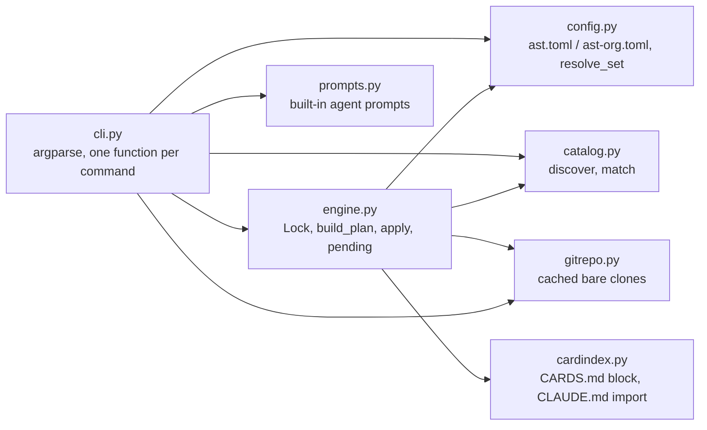

# architecture

How the `aisetup` package turns config files into installed tools.

Dependencies point one way: `cli` → `engine` → `config` / `catalog` / `gitrepo`. The leaf
modules (`config`, `catalog`, `gitrepo`, `cardindex`) do not import each other. `errors.AstError` is the only exception the CLI
catches; raise it for anything the user can act on, and `main` prints it and exits 2.

## The two modes

`cli.find_root` walks up from the working directory. A directory with `ast.toml` is a
**project**; one with only `ast-org.toml` is an **org repo**. `--org` or `--set` forces org
mode when both files exist. `add`, `rm`, `enable`, `disable`, `list`, `status` and `source`
have a project branch and an org branch in the same function.

## Project flow

Every project command that changes something follows the same shape:

1. Load `ProjectConfig` and `Lock`.
2. `build_plan(strict=False)` to get the catalog, then edit the config **in memory**.
3. `cli.sync`: `build_plan` again (strict), `apply`, then save config and lock.

Because saving is last, a command that fails leaves both files untouched.

`build_plan` produces a `Plan`: the org commit and its parsed `ast-org.toml`, each `Source`
pinned to a commit, the catalog of every tool those sources offer, and the wanted tools
(set tools + `tools.add` − `tools.disable`) with their git tree ids. It reuses locked
commits unless `refresh` says otherwise, so only `ast update` moves a source.

`apply` compares the plan with the lock and the files on disk, copies or removes files, and
rewrites the lock in memory.

## Org flow

Org-mode commands edit `ast-org.toml` directly through `OrgConfig`. There is no lock and
nothing is installed. `cli.org_catalog` lists the tools of the org's sources; for the source
`.` it walks the working tree, so a new skill can be added to a set before it is committed.

## Prompts

`ast prompt <name>` prints text for a coding agent. `prompts.py` holds the built-in ones
(`setup`, `adopt`, `update`, `org`) as templates with no logic beyond inserting their arguments. Any source,
including the org repo, can offer more as `prompts/<name>.md`; `cli.source_prompts` reads
them from the locked commit (or from the working tree in an org repo). They are never
installed. A `{{include path}}` line is replaced by that file from the same repo
(`prompts.expand`, one level). A built-in name wins over a source prompt of the same name,
with one exception in spirit: `ast prompt setup` appends the org repo's `prompts/setup.md`
as extra steps. With a repo argument it reads that repo's default branch directly, so it
works before the project uses the org repo; with none it uses the org repo in use. The command works
outside a project, where only the built-ins exist.

## Git access

`gitrepo.Repo` keeps one bare clone per URL under `~/.cache/ast/repos/` and reads it with
`ls-tree`, `rev-parse`, `show` and `archive`. Nothing is ever checked out. A URL is fetched
at most once per process (`_fetched`); tests clear that set between CLI calls.
